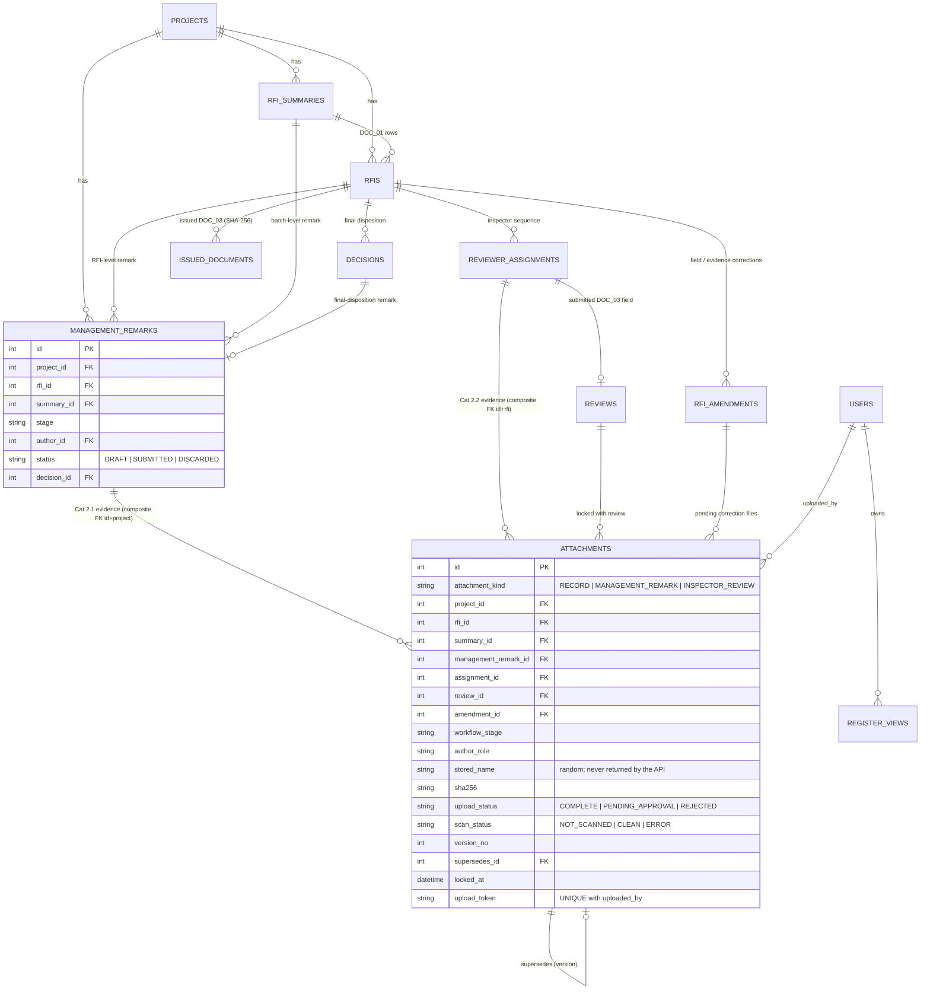

# Database schema changes and ERD — release 6.0.0-ui

All changes are **additive**. They are applied by `backend/scripts/migrate_ui_v1.py` after `migrate_srs_v5.py`. No table, column or row is dropped or modified. Existing values are never changed; new columns are filled only where NULL.

## New tables

### `management_remarks`
A Category 2.1 (RE/DRE) remark. It is a distinct record that owns its own evidence.

| Column | Type | Notes |
|---|---|---|
| id | INT PK | |
| project_id | INT FK projects | |
| rfi_id | INT FK rfis NULL | RFI-level remark |
| summary_id | INT FK rfi_summaries NULL | DOC_01 batch; also set for RFI-level remarks of a batch |
| stage | VARCHAR(30) | `DOC01_REVIEW`, `ASSIGNMENT`, `SEQUENCE_CHANGE`, `REASSIGNMENT_RETURN`, `FINAL_DISPOSITION` (CHECK) |
| author_id | INT FK users | The authenticated author; never client-supplied |
| author_role | VARCHAR(60) | Project role at creation |
| author_name_snapshot | VARCHAR(150) | Name at creation |
| body | TEXT NULL | |
| status | VARCHAR(20) | `DRAFT`, `SUBMITTED`, `DISCARDED` (CHECK) |
| decision_id | INT FK decisions NULL | Set for final-disposition remarks |
| client_request_id | VARCHAR(64) UNIQUE NULL | Idempotent creation |
| created_at, updated_at, submitted_at | DATETIME | Server time (UTC) |
| version | INT | Optimistic concurrency |

Constraints: `UNIQUE(id, project_id)` (target of the composite FK below) and `CHECK (rfi_id IS NOT NULL OR summary_id IS NOT NULL)`.

### `register_views`
Saved DOC_02 views per user: `user_id`, `project_id`, `name`, `config_json` (filters, sort, columns, advanced toggles, page size). Constraint: `UNIQUE(user_id, project_id, name)`.

## New columns

| Table | Columns | Purpose |
|---|---|---|
| attachments | attachment_kind, project_id, rfi_id, summary_id, management_remark_id, assignment_id, review_id, amendment_id, workflow_stage, author_role, sha256, upload_status, scan_status, scanned_at, version_no, supersedes_id, superseded_at, locked_at, upload_token, removed_at, removed_by | Evidence metadata (see `03_ATTACHMENT_ARCHITECTURE.md`) |
| reviewer_assignments | draft_comment, draft_saved_at | Active inspector's private unsent comment |
| reviews | reviewer_name_snapshot, reviewer_role_snapshot, attachment_count | Sign-off identity and evidence count at submission |
| decisions | decided_by_name_snapshot, designation_snapshot | Decision-maker and designation at decision time |
| rfi_amendments | amendment_type, target_assignment_id, target_remark_id | Evidence corrections (`REVIEW` / `REMARK`) alongside DOC_01 field amendments |

## New indexes and constraints

| Object | Definition |
|---|---|
| `uq_assignment_id_rfi` | UNIQUE `reviewer_assignments(id, rfi_id)` |
| `uq_attachment_upload_token` | UNIQUE `attachments(uploaded_by, upload_token)` (idempotent uploads; NULL tokens allowed for old rows) |
| `fk_attachment_remark_project` | `attachments(management_remark_id, project_id)` → `management_remarks(id, project_id)`: a remark's file must belong to the remark's project |
| `fk_attachment_assignment_rfi` | `attachments(assignment_id, rfi_id)` → `reviewer_assignments(id, rfi_id)`: a review's file must belong to that review's RFI |
| `ck_attachment_path` | CHECK: a `MANAGEMENT_REMARK` file has a remark and no assignment; an `INSPECTOR_REVIEW` file has an assignment and an RFI and no remark; a `RECORD` file has neither |
| single-column FKs | project, rfi, summary, review, amendment, supersedes (self), removed_by; amendment target FKs |
| indexes | attachment_kind, project_id, rfi_id, summary_id, management_remark_id, assignment_id, amendment_id |

`test_database_constraints_reject_invalid_evidence_relationships` shows the database itself rejects invalid rows, independently of the API.

**Compatibility.** The previous release (5.1) still runs on the migrated schema. Its inserts leave `attachment_kind` NULL, and the CHECK passes for NULL. This was tested on the rehearsal copy, so a rollback does not need a database restore.

## ERD (changed area)

## Startup schema check

`app/main.py` refuses to start (and creates nothing) if the release-6 columns are missing. Its message names both migration scripts, so the new release can never run against an unmigrated database.
